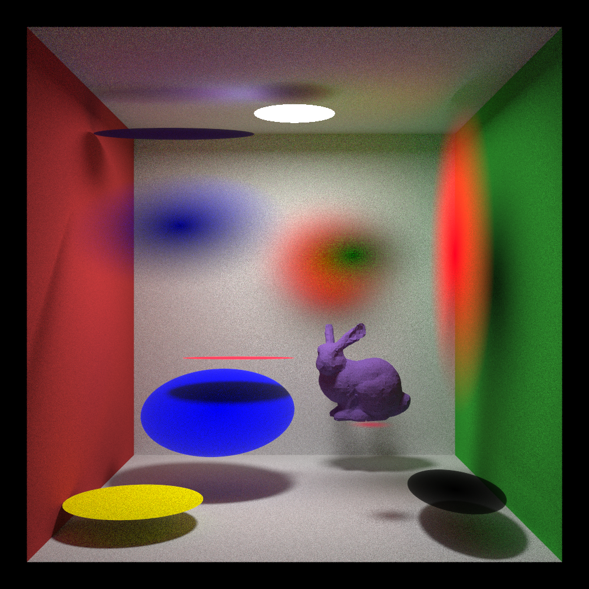
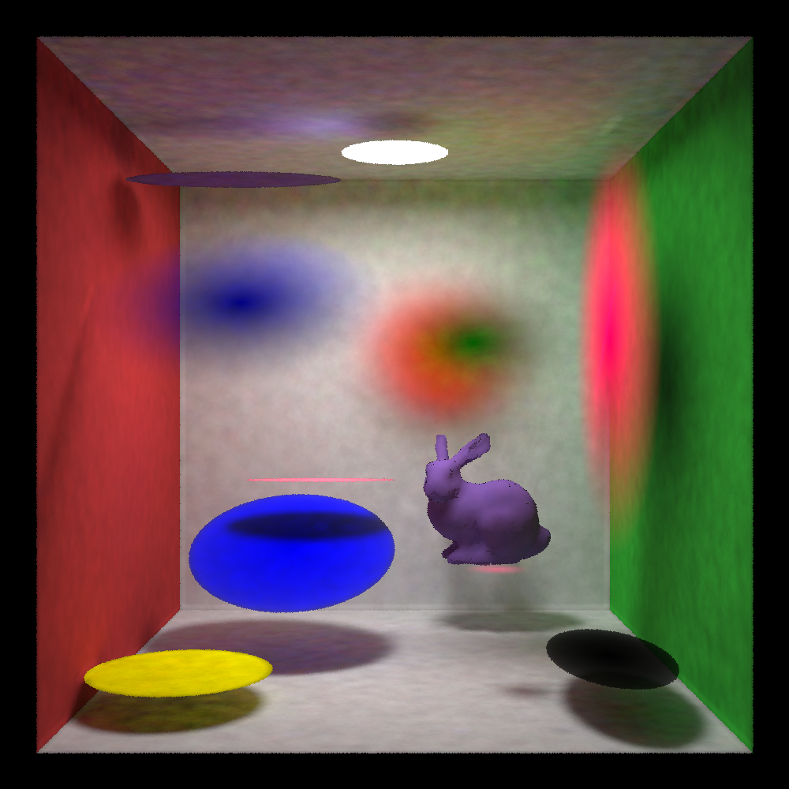

## Overview

This project is a **SYCL 2020 compliant** physically based differentiable renderer. It must be compiled with a **SYCL 2020 compliant compiler toolchain**. The setup below uses **LLVM/Clang 20** together with **AdaptiveCpp (ACPP)** on **Ubuntu 24.04**.

To render the included test scene, the required steps are:

1.  Install the base system dependencies
2. Install **LLVM/Clang 20**
3. Install **AdaptiveCpp (ACPP)**, providing **SYCL 2020** compilation support
4. Clone this repository **with submodules**
5. Configure and build the project with **CMake** using the **ACPP toolchain**
6. Run the test scene


## Building on Ubuntu 24.04

The project is tested to build on a clean Ubuntu 24.04 setup with LLVM/Clang 20 and AdaptiveCpp.

### Requirements
- A fresh Ubuntu 24.04 install

### 1. Install base system dependencies

```bash
sudo apt update
sudo apt install -y \
  ca-certificates \
  curl \
  wget \
  gnupg \
  git \
  pkg-config \
  build-essential \
  ninja-build \
  cmake \
  python3 \
  python3-pip \
  python3-dev \
  libpython3-dev \
  zlib1g-dev \
  xz-utils \
  libopenexr-dev
```

### 2. Install LLVM/Clang 20 from apt.llvm.org


```bash
apt install lsb-release wget software-properties-common gnupg

wget https://apt.llvm.org/llvm.sh
chmod +x llvm.sh
sudo ./llvm.sh 20
rm llvm.sh
```

Install the LLVM 20 development packages required by this project and AdaptiveCpp:

```bash
sudo apt update
sudo apt install -y \
  llvm-20-dev \
  llvm-20-tools \
  libclang-20-dev \
  libclang-common-20-dev \
  lld-20 \
  libomp-20-dev
```

Set convenient defaults for the current shell:

```bash
export CC=clang-20
export CXX=clang++-20
```

Optional: To make this persistent, add both lines to `~/.bashrc`.

### 3. Install AdaptiveCpp

```bash
git clone https://github.com/AdaptiveCpp/AdaptiveCpp.git
cmake -S AdaptiveCpp -B AdaptiveCpp/build \
  -G Ninja \
  -DCMAKE_BUILD_TYPE=Release \
  -DCMAKE_INSTALL_PREFIX=/opt/AdaptiveCpp \
  -DCMAKE_C_COMPILER=clang-20 \
  -DCMAKE_CXX_COMPILER=clang++-20 \
  -DLLVM_DIR=/usr/lib/llvm-20/cmake \
  -DACPP_COMPILER_FEATURE_PROFILE=full
cmake --build AdaptiveCpp/build -j"$(nproc)"
sudo cmake --install AdaptiveCpp/build
```

Expose AdaptiveCpp to your shell:

```bash
export PATH=/opt/AdaptiveCpp/bin:$PATH
export CMAKE_PREFIX_PATH=/opt/AdaptiveCpp:$CMAKE_PREFIX_PATH
```

Optional: To make this persistent, add both lines to `~/.bashrc`.

### 4. Clone the repository

Clone with submodules:

```bash
git clone --recurse-submodules https://github.com/M-Gjerde/DifferentiablePointRendering.git
cd DifferentiablePointRendering
```

If you already cloned the repository without submodules:

```bash
git submodule update --init --recursive
```

### 5. Configure and Build the project

Note: Build in debug mode, Release mode doesn't work due to clang compiler crash caused by SYCL combined with c++ modules.

```bash
cmake -S . -B build \
  -G Ninja \
  -DCMAKE_BUILD_TYPE=Debug \
  -DCMAKE_C_COMPILER=clang-20 \
  -DCMAKE_CXX_COMPILER=clang++-20 \
  -DCMAKE_PREFIX_PATH=/opt/AdaptiveCpp
```

#### Build:

```bash
cmake --build build -j"$(nproc)"
```

## 6. Render a test scene:
```bash
cd build
./DifferentiablePointRendering points.ply cbox.xml
```
You should end up with two rendered images like this:

(Left: Light tracing rendering. Right: Photon mapping)
<p align="center">   </p> ```

### Troubleshooting

If CMake cannot find AdaptiveCpp, verify that these environment variables are set:

```bash
export PATH=/opt/AdaptiveCpp/bin:$PATH
export CMAKE_PREFIX_PATH=/opt/AdaptiveCpp:$CMAKE_PREFIX_PATH
```

If the repository was cloned without submodules, run:

```bash
git submodule update --init --recursive
```


### Optional: build Python bindings
Python bindings builds a python library of the renderer.
Note: Build in debug mode, Release mode doesn't work due to clang compiler crash caused by SYCL combined with c++ modules.
```bash
cmake -S . -B build \
  -G Ninja \
  -DCMAKE_BUILD_TYPE=Debug \
  -DCMAKE_C_COMPILER=clang-20 \
  -DCMAKE_CXX_COMPILER=clang++-20 \
  -DCMAKE_PREFIX_PATH=/opt/AdaptiveCpp \
  -DBUILD_PYBIND=ON

cmake --build build -j"$(nproc)"
```

### Export a relightable reconstruction to Blender

Final mesh extraction also creates `mesh/reconstruction.glb` with a UV texture
baked directly from reconstructed surfel albedo, editable point lights, and
cameras. Pressing **S** during training also exports a GLB for that snapshot;
scheduled mesh intervals remain PLY-only. See [glTF export](docs/gltf_export.md) for texture resolution, exporting
existing meshes, and Blender import settings.

### Inspect raw linear predictions

Set `save_snapshot_linear_raw: bool = True` in `python/config.py`, or pass
`--save-snapshot-linear-raw`, to save lossless 32-bit float RGB EXRs alongside
scheduled image snapshots. This is independent of `save_snapshot_rgb` and uses
its existing image-snapshot schedule (`save_interval > 0`). Files are written to
`renders/<camera>/linear_raw/<iteration>_linear_raw.exr`, plus
`renders/linear_raw_initial_<camera>.exr` and `renders/linear_raw_final_<camera>.exr`.
Training's **s** + Enter manual snapshot always writes the final-named EXRs,
even when the scheduled flag is off.

These files contain the returned `raw[..., :3]` values with no clipping,
normalization, exposure, sRGB/gamma encoding, alpha multiplication or division.
They use RGB channels only so image inspectors do not apply coverage alpha a
second time. Disable automatic exposure/tone mapping in your EXR inspector when
examining numeric values. Snapshots follow the existing render timing: manual
and scheduled snapshots may re-render the current parameters; they are not a
capture of an earlier optimizer step's stochastic sample.

The real-time viewer also offers **Display → Raw linear RGB**. Its screen/PNG
preview clips to [0,1]; the training EXRs preserve the original float values.

### Monitor optimization metrics

Inactive-transport pruning accumulates a combined camera and shadow support score
between pruning operations. A camera hit contributes its incoming
transmittance times its symmetric slab member weight. A shadow hit contributes
the receiver's camera weight times incoming shadow transmittance times the
blocker's effective opacity. Thus ten fully effective hits score 10, while one
hundred hits of weight 0.1 also score approximately 10. This score does not
depend on BSDF brightness or gradient magnitude and does not change opacity.

`--prune-interval` (default `100`) schedules transport, area, and opacity pruning
together; `0` disables all pruning. Transport scores are normalized to one camera
pass by multiplying accumulated support by the number of training views and
dividing by each surfel's observed camera-sample count. Thus changing the interval
does not multiply the threshold's effective scale.
`--inactive-transport-min-score` defaults to `10`; scores at or above this
threshold survive, and `0` disables transport pruning alone. The former
`--inactive-transport-prune-cycles` setting has been removed. New surfels accumulate
their own samples and are exempt until they have at least one camera pass's worth
of observations. This is not a guaranteed 100-iteration lifetime for new surfels.
The existing pruning start and topology freeze still apply.
When pruning and densification coincide, all scheduled removals are excluded from
densification selection. Children are created only from surviving parents and
begin accumulating transport support for the next pruning interval.
`renderer.get_primal_activity_stats()` returns per-render
`camera_surface_score` and `shadow_occluder_score` arrays alongside the raw hit
counts. Rebuild `pale` when updating Python training code to use these scores.
These statistics track camera and direct shadow support; they do not separately
measure indirect-light importance or the loss change from deleting a surfel.

Pass `--metrics` to launch the live metrics viewer alongside training. When
`--gt` is present, `main.py` computes geometry scores at mesh extraction
checkpoints and writes them to `geometry_metrics.csv`; the viewer reads that
trail instead of repeating the Chamfer calculation:

```bash
python python/main.py -s dataset -o output --metrics --gt ground_truth.ply
```

### Camera coverage loss

`alpha_loss_weight` (CLI `--alpha-loss-weight`; `0` disables it) adds
`weight / (2*N) * sum(mask * (A - target_alpha)^2)` to the existing RGB
half-MSE, which is averaged over `3*N` channel samples. Thus weight `1` gives
alpha the same overall loss weight as averaged RGB; weight `1/3` gives it the
same per-channel coefficient as R, G, or B. Choose a weight experimentally.

`A` is the RAW framebuffer's physical camera coverage. RGB targets imply
`target_alpha=1`; the native `upload_training_targets` API also accepts float32
RGBA targets. Rays with no geometric surfel interaction are excluded, including
ordinary background. Zero-opacity surfel intersections remain eligible.
Incomplete traversals are excluded rather than treated as escape. Opaque meshes
terminate coverage at one. The framebuffer's physical alpha is unchanged.

The deterministic alpha adjoint differentiates the same camera slab transmission
product through stored opacity, position, local rotation, both scales, and the
`beta` footprint profile. The unused `shape` field has no forward dependence and
therefore no derivative. Hit membership, slab membership, and traversal decisions
are discrete; no boundary derivatives are introduced. This is a primary-camera
term only, evaluated once regardless of adjoint sample or bounce counts. It
requires photon mapping with `CameraGatherKernel2`; unsupported integrators fail
explicitly when alpha adjoints are requested.

Set `alpha_loss_opacity_only=True` (CLI `--alpha-loss-opacity-only`) to detach
position, rotation, both scales, and beta **for the alpha term only**. The forward
loss and its opacity derivative stay identical. RGB and other regularizers can
still update geometry. Setting the option false retains full footprint
gradients; `--no-alpha-loss-opacity-only` explicitly restores them. This option
prevents this loss from directly expanding/moving footprints to increase coverage.
It can still strengthen incorrect surfaces, and opacity saturation may leave a
nonzero loss where footprint weights prevent full coverage.

The loss can also improve coverage by moving/expanding footprints or strengthening
incorrect geometry. It does not identify the correct surface or require each
surfel on a ray to be opaque. Densification statistics retain their separate RGB
signal. The implementation adds a camera traversal for eligibility and another
for the alpha backward pass when enabled; neither performs lighting queries.

Native loss results expose total image `loss_values`, RGB `l2_loss_values`, and
weighted `alpha_loss_values`. Training CSVs record `loss_alpha_weighted_mean`.
`evaluate_loss_from_current_forward` evaluates the current RAW framebuffer without
replacing it with adjoints. Call it immediately after forward rendering.
`render_backward` accepts RGB or RGBA cotangents; RGB inputs seed zero alpha,
and explicit RGBA inputs differentiate physical coverage without the loss mask.
